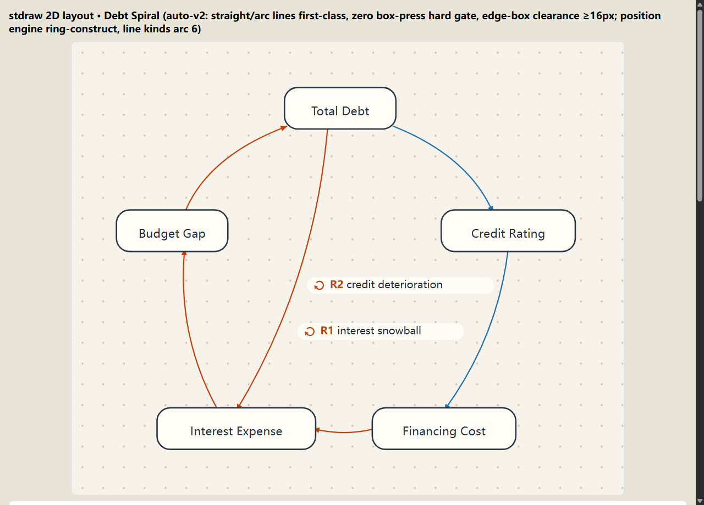
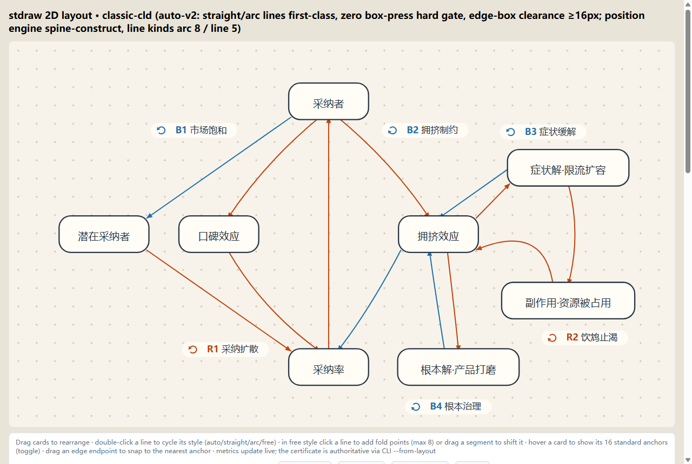
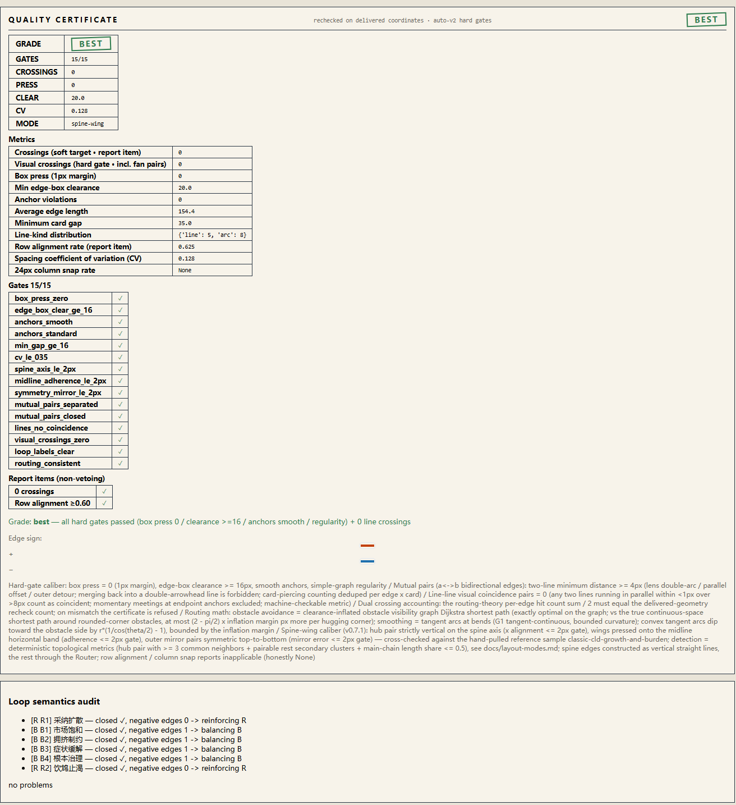

<div align="center">

# stdraw

**Planarity-aware system-thinking (CLD) diagram engine. Honest grades, hard quality gates, metric-backed certificates.**

*Text DSL in → diagram with a quality certificate out. Honest grades, never fake "zero crossings" claims.*

**Scale expectations, up front: recommended ≤ 10 nodes · classic recipe ~10 s per figure (graphviz-dot: 0.03 s — stdraw is 2–3 orders of magnitude slower by design, trading speed for hard quality gates + a machine-readable certificate) · n ≥ 50 not recommended.** Numbers: [benchmarks/REPORT.md](benchmarks/REPORT.md)

English | [中文](README_zh-CN.md)

</div>

[](https://github.com/jacky510/stdraw/actions/workflows/ci.yml)
[](LICENSE)
[](pyproject.toml)
[](https://github.com/jacky510/stdraw/stargazers)

[Install](#install) · [Gallery](#gallery) · [Quickstart](#quickstart) · [DSL](#dsl-in-one-minute) · [Certificates](#certificates--quality-gates) · [Agent Integration](#agent-integration)

```bash
pip install stdraw
```

---

## What & Why

Mainstream diagram tools stop at "crossing minimization" heuristics, and **none of them make a verifiable promise about their own output**. stdraw is built the other way around:

- **auto-v2 (default recipe)**: **structure-aware mode layout** — a deterministic priority chain (symmetric → bowtie-vertex → spine-wing → comb-bilateral → column-chain → ring-cycle → lens-chain → layered) picks one arrangement template per graph structure, each with a trial gate (non-triggering graphs stay byte-identical); plus straight/arc-first routing (optional CP-SAT refinement), enforced by **hard quality gates**: box-over-line = 0 (any angle), edge-to-box clearance ≥ 16px, smooth border anchors, and mode-specific regularity gates — see [docs/layout-modes.md](docs/layout-modes.md) (zh original; self-contained English edition: [docs/layout-modes.en.md](docs/layout-modes.en.md));
- **Ring layout for loop-dominated small graphs (v0.5.0)**: when a small graph (≤ 12 nodes) has a dominant simple cycle covering ≥ n−2 nodes (or ≥ 90% of its edges lie on cycles), the main loop is placed on **regular-polygon ring slots** in cycle order (declared loop order preferred, so R/B polarity colors read along the ring), chords route inside the ring, and residual nodes get deterministic inner/outer slots; the certificate switches to **ring-appropriate metrics** (ring-spacing CV + polygon template-fit error) instead of row alignment — layout mode is stated honestly, never judged by row-gate yardsticks; non-triggering graphs keep the layered path byte-identical;
- **Loop-reading layer**: every declared loop gets a **loop-center label** (id + name + a direction glyph; polarity stays color-only — no +/− badges on labels), shown by default with a `Loops: on/off` toggle on the demo page; an edge that belongs to a loop of ≥ 3 nodes is drawn as a **loop-side arc** by default — bending along its loop, away from the loop's centroid, so the loop reads as a ring — while straight lines and detour polylines are scored fallbacks whose measured reasons are written to `certificate.json` → `loop_arcs.fallbacks`; `a -> + b @delay` marks a delay with a double tick at the edge midpoint (round-trips through `graph.cld`). Labels and ticks are hard-gated (`loop_labels_clear`, `delay_marks_clear`: no box, line or label overlap); the whole annotation layer (labels + delay marks, one switch) can be suppressed at render time with `--no-loop-labels` — the certificate then records the two annotation gates as `N/A` (grade semantics unchanged). The demo headline and the CLI summary print the **delivered** line-kind counts (`metrics.line_kind_counts`), never the `--linestyle` request value — caliber: [docs/grading-contract.md](docs/grading-contract.md) Appendix B and [docs/edge-placement-rules-v1.md](docs/edge-placement-rules-v1.md) §20;
- **Anchor-band hard gate (v0.7.3)**: delivered edge anchors clamped to the mid-band (edge midpoint ± 1/4 edge length, corner hits = 0) are now enforced per-figure in CI — spine-wing figures require 100% in-band; mutual-pair edges whose band-clamped anchors cannot pass the hard gates get a deterministic band-anchored local re-route (anchor-band candidates + nested-arc escape hatch + own-box interior check); other engines are locked to their v0.7.2 baseline ratios (ring mutual corridors / bowtie ±12px spoke corridors are registered legacy) — see [docs/layout-modes.md](docs/layout-modes.md) (zh original; self-contained English edition: [docs/layout-modes.en.md](docs/layout-modes.en.md));
- **Layout aesthetics v3.1 (v0.7.1)**: **spine-wing mode** — graphs with a dominant hub pair (an edge whose endpoints share ≥3 common neighbors = a midline "wing band") plus a constructible secondary cluster get the vertical-spine + midline-wing layout (jacky's hand-drawn classic-cld reference): spine strictly vertical on the axis, wings pressed to the horizontal midline, outer mirror pair symmetric about it; deterministic trigger (hub-pair common-neighbor count + rest-cluster pairing + spine length ratio ≤0.5), equivalent certificate gates (spine-axis ≤2px, midline ≤2px, mirror ≤2px); corpus sweep: only classic-cld-growth-and-burden switches, all other 18 byte-identical — see [docs/layout-modes.md](docs/layout-modes.md) (zh original; self-contained English edition: [docs/layout-modes.en.md](docs/layout-modes.en.md));
- **Layout aesthetics v3 (v0.7.0)**: **bowtie-vertex mode** — graphs whose topology is exactly two simple cycles sharing one node (e.g. wage-price-spiral, per jacky's hand-drawn reference) get an explicit double-mirror layout (shared node dead-center, one loop per half-plane, symmetric rows, all-straight lines with mutual-pair parallel corridors); **connection-point caliber** — line anchors clamp to each edge's mid-point ±1/4 band (corners excluded entirely, hit count always 0), multiple lines on the same side fan out symmetrically around the mid-point; **adaptive arc curvature** — bulge = min(6 + 0.06·chord, 40) px (short edges bend less, long edges capped), arcs within one symmetric structure share a single unified k for visual evenness — see [docs/layout-modes.md](docs/layout-modes.md) (zh original; self-contained English edition: [docs/layout-modes.en.md](docs/layout-modes.en.md));
- **Layout aesthetics v2 (v0.6.0)**: regularity first — long-chain / few-loop graphs (main cycle ≤ 4) get a **vertical column layout** (spine aligned on one axis, branches on neighbor side columns, the spine's closing edge drawn as a big side arc for the loop-closure feel); bowtie graphs (two triangles sharing an edge, e.g. learning-flywheel) get an **explicit mirror-symmetric layout** with a strict line-type rule (axis edge straight + mirrored side arcs); loop edges are **colored by polarity** (UI-A light theme: R = vermilion `#c2410c`, B = drafting blue `#1e6fae`; dark theme: `#ffb454` / `#6ec6ff` — single source `stdraw/themes.py`, mixed/acyclic = neutral, negative edges dashed) replacing the old R/B letter badges; isomorphic skeletons map to the same layout template (WL structural colors drive slot assignment, not declared-loop ids); crossings and row alignment are demoted from hard gates to **reported soft targets** (order & beauty first) while arrangement regularity stays hard-gated — see [docs/layout-modes.md](docs/layout-modes.md) (zh original; self-contained English edition: [docs/layout-modes.en.md](docs/layout-modes.en.md));
- **WS3 routing math**: detours are **provably shortest** — obstacles inflated by the clearance, then an exact Dijkstra shortest path over the corner visibility graph (graph-optimal); polyline corners are smoothed with tangent circular arcs (G1-continuous, bounded curvature, per-arc clearance re-verified); crossings are re-checked in **dual calibers** — the router's theoretical count on final geometry must equal the geometric recount on delivered coordinates, or no certificate is issued; loop polarity is expressed by **edge color** (vermilion = reinforcing R, drafting blue = balancing B in the light theme, dashed = negative edge) with no letter badges cluttering complex graphs; polyline detours carry a fixed type cost (arc > straight > polyline — folded corners are a last resort);
- **Honest grading**: if it can't earn a certificate it says so — **never claims 0 crossings for arbitrary graphs** (in auto-v2, crossings are minimized, not guaranteed);
- **Two-layer ground-truth box measurement**: the layout side plans box bounds from worst-case real-font metrics; the verification side measures actual DOM bounds in a real browser after rendering — certificates verify rendered reality, not estimates;
- **Quality certificates**: every deliverable ships with quantified metrics (crossings / box-over-line / clearance / alignment / CV / anchors), verified on the delivered coordinates;
- **Determinism**: same input → same output, byte-identical (CP-SAT pinned to a single worker + fixed seed); diagrams are safe to commit with clean diffs.

### Recommended scale (≤ 10 nodes, honest boundary)

**Recommended: no more than 10 nodes** — the measured boundary for "CP-SAT proves optimality + full `_polish` refinement + all hard quality gates passing" (classic CLD small-graph domain, n10 ≈ 45–60 s per figure). Up to 12 nodes can trigger the ring-cycle layout (loop-dominated small graphs). n=20–30 do render after the WS5 fix (random sparse family: 20/20 at n20 and n30), but placement degrades from "proven optimal" to "best incumbent within a deterministic budget", box-over-line / clearance are no longer guaranteed at 0, and runtime stays 2–3 orders of magnitude above baselines; n≥50 is not recommended (19/20 at n50). Numbers per [benchmarks/REPORT.md](benchmarks/REPORT.md) §4/§5 (Chinese).

## Gallery

All images are real renderings produced by the current engine (v0.9.0) from the in-repo corpus — no mock-ups, no stale artifacts (click through to each demo).

<table>
  <tr>
    <td><a href="demos/debt-spiral-2d-en.html"></a></td>
    <td><a href="demos/classic-cld-2d.html"></a></td>
  </tr>
  <tr>
    <td><strong>2D · auto-v2 ring layout</strong> (debt-spiral, 5n/6e, a textbook debt-spiral feedback loop drawn as a clean ring — 0 crossings, gap 75.6 px; edges colored by sign: + vermilion / − drafting blue, all solid; loop labels R1 / R2 at the loop centers, all 6 loop edges arc along the ring)</td>
    <td><strong>2D · auto-v2 spine-wing layout</strong> (classic-cld growth-and-burden, 8n/13e, spine x-alignment + midline adherence + mirror-symmetric wings — 0 crossings, gap 35.0 px; edges colored by sign: + vermilion / − drafting blue, all solid; loop labels R1 / B1–B4 / R2 at the loop centers)</td>
  </tr>
  <tr>
    <td colspan="2" align="center"><a href="demos/classic-cld-2d.html"></a></td>
  </tr>
  <tr>
    <td colspan="2" align="center"><strong>Quality certificate panel</strong> (hard gates + gate tally + honest grade, exactly as shipped in the demo; spine-wing caliber: spine-axis / midline-adherence / mirror deviation)</td>
  </tr>
</table>

## Ask your agent in plain words

stdraw is agent-native: one `.cld` text file in, a certified diagram out. Tell your agent:

| You say | The agent runs |
|---|---|
| "Draw this causal-loop diagram with a quality certificate" | `stdraw layout model.cld --outdir out` |
| "Audit the declared feedback loops: unclosed loops? wrong polarity?" | reads `out/loops_audit.json` → `problems` (loops re-enumerated independently) |
| "Can this diagram be zero-crossing? Tell me straight, no bragging" | reads `out/certificate.json` → `grade` (honest grading, below) |
| "Give me a printable version" | opens `out/demo-2d.html` (inline SVG, zero network) |

## Project Structure

```text
stdraw/
├── stdraw/              # Python package
│   ├── recipes.py       #   recipe registry: auto-v2 (default) / candidate-v1 (opt-in)
│   ├── layout_auto.py   #   auto-v2 layout (layering + crossings-in-objective + optional CP-SAT + local refinement)
│   ├── routing.py       #   straight/arc/detour routing (box-over-line=0, clearance>=16px hard gates)
│   ├── textmetrics.py   #   ground-truth box bounds (layout side: worst-case real-font metrics)
│   ├── rendercheck.py   #   ground-truth box bounds (CI side: headless-browser DOM measurement, optional layer)
│   ├── visibility.py    # WS3: routing math (inflated-obstacle visibility-graph shortest path + arc smoothing)
│   ├── crossing_exact.py  # WS2: exact crossing-number layer (ordering insertion ILP + planarization oracle + B&B squeeze, optional ortools)
│   ├── regularity.py    # WS2: structure detection + computable regularity definitions (polygon deviation / straightness / symmetry axis)
│   ├── placement.py     # WS2: slot-discretized placement (structure-driven slot types; CP-SAT on the general branch)
│   ├── ringlayout.py    # v0.5.0: loop-dominated ring layout (trigger detection + main-ring polygon slots + residual assignment)
│   ├── columnlayout.py  # v0.6.0: column layout (long-chain/few-loop: spine in one column + side branches + closing side arc)
│   ├── symlayout.py     # v0.6.0: bowtie-pair symmetric layout (two triangles sharing an edge: vertical-axis mirror + consistent line kinds)
│   ├── planar.py        #   internal planar module (candidate_planar.py dependency; not a recipe)
│   ├── metrics.py       #   quality certificate + honest grading
│   ├── check.py         #   geometry self-checks (CI-gate form: hard-gate checks)
│   ├── loops.py         #   loop-semantics audit (lint)
│   ├── dsl.py           #   .cld DSL parser
│   ├── model.py         #   graph data model
│   ├── render.py        #   2D HTML rendering (inline SVG, v1/v2 forms, --theme light|dark)
│   ├── themes.py        #   design tokens: single source for the light/dark palettes
│   └── __main__.py      #   CLI: stdraw layout ... [--recipe auto|candidate-v1] [--linestyle straight|arc] [--no-loop-labels] [--theme light|dark]
├── examples/            # .cld cases (limits-to-growth / classic-cld-growth-and-burden)
├── demos/               # deliverable form: 2D demos + certificate JSON
├── skills/stdraw/       # Agent Skill (installable via skills add)
├── docs/                # DSL spec (EN + zh-CN) + gallery + OR-Tools comparison + crossing-exact math (WS2)
└── .github/workflows/   # CI: hard gates + DOM measurement + determinism
```

## Quickstart

```bash
# 1. Install (pure pip; the only hard dependency is networkx)
pip install stdraw

# 2. Run a case: text DSL in
stdraw layout examples/limits-to-growth.cld --outdir out --pitch 62

# 3. Look at the deliverables
#    out/demo-2d.html     — 2D layout + embedded quality certificate
#    out/certificate.json — metrics + honest grade
#    out/loops_audit.json — loop-semantics audit
```

A ready-made deliverable ships in the repo: open [`demos/classic-cld-2d.html`](demos/classic-cld-2d.html).

### Manual touch-up loop (drag → export → re-certify)

Ship the page with the built-in touch-up layer via the `--interactive`
opt-in (the default CLI page is the static diagram + certificate):
drag nodes (mouse or touch), live metrics recompute in the toolbar, then:

```bash
stdraw layout input.cld --outdir out --interactive
# 1. Open out/demo-2d.html, drag cards, click "Export layout"
#    -> downloads graph-manual-layout.json (layout.json-compatible subset)

# 2. Re-run routing + certificate on YOUR coordinates — same hard gates,
#    honest scoring (a manual layout is never graded leniently):
stdraw layout input.cld --outdir out-manual --from-layout graph-manual-layout.json

# 3. (optional) Side-by-side auto-vs-manual certificate comparison
#    (the gap is the engine-vs-human aesthetic distance) — a repo tool,
#    not part of the installed package:
python tools/compare_auto.py input.cld \
    --from-layout graph-manual-layout.json --outdir out-manual

# 4. Three-layer diff (node-level moves / structural metrics / loop semantics)
#    — the data source for distilling aesthetic rules from human edits
#    (repo tool, not part of the installed package):
python tools/layoutdiff.py out/layout.json out-manual/layout.json --cld input.cld --out diff.json
```

### Waypoint handles (detour fold points are draggable, not fixed)

Since v0.5.3 the touch-up layer (`--interactive` pages) re-routes **all line
styles live** while you drag
(straight / arc / visibility-graph fold lines alike — fold vertices are
recomputed every frame against current obstacles; nothing is pinned). Edges that
detour around obstacles render each fold point as a small **drag handle**
(hover shows a move cursor):

- drag a handle → that edge becomes *user-pinned*; node drags afterwards only
  re-anchor its endpoints, your waypoints stay;
- "Export layout" writes `edges: [{a, b, waypoints: [[x,y],...]}]` for pinned
  edges; `--from-layout` replays the exact same polyline (anchors recomputed on
  the box borders toward the first/last waypoint) and the certificate re-checks
  the delivered geometry honestly — including your waypoints;
- "Reset" clears all pins and restores the engine layout.

```bash
# after dragging handles + export:
stdraw layout input.cld --outdir out-manual --from-layout graph-manual-layout.json
# layout.json now carries route kind "waypoints" with via = your fold points
```

### Line style control & manual fine-tuning (v0.7.7)

Automatic line-style rule: **loop-member edges default to an arc** — an edge
that belongs to a declared loop of ≥ 3 nodes bends along its loop (bulging
away from the loop's centroid, so the loop reads as a ring); **straight lines
and detour polylines are the fallback**, chosen only when the preferred arc is
not deliverable (box press, clearance, anchor angle), and every fallback is
recorded with its measured reason in `certificate.json` → `loop_arcs.fallbacks`.
Edges outside any loop keep straight as the default; mutual pairs always take
their lens corridors, and mode-specific aesthetics still apply (e.g. the
spine-wing midline arcs). Bilateral
supply-chain graphs (K_{m,2}: every source feeding two non-adjacent hubs)
get the new **comb-bilateral** placement — sources in one vertical column,
the two hubs in mirrored left/right slots, all hub edges a straight fan.

Per-edge manual control on the demo page:

- **double-click a line** to cycle its style `auto → straight → arc → free →
  auto` (a >=10px hover hit zone, pointer cursor + highlight; node drags
  are never disturbed). Forced styles re-route live and the top-bar metrics
  recompute honestly — red when a hard gate fails, no leniency;
- **free style**: click anywhere on the line to insert a fold handle and
  drag it — the user segment is an **exact polyline** (WYSIWYG, no
  smoothing), anchors recomputed on the box borders toward the first/last
  fold point. At most **3 fold points per edge**; at the cap a click
  selects the nearest handle with the tooltip "max 3 points per edge";
- **Export layout** now also writes `edges[].style` (free fold points ride
  along as `waypoints`); `--from-layout` replays forced straight/arc/free
  styles under the same deterministic rules and the certificate re-checks
  them honestly;
- **Reset** clears pins, styles and fold points back to the engine default.

Two integration hooks for embedding pages:

```js
// apply a layout programmatically (the inverse of "Export layout")
window.__stdrawApplyLayout({
  nodes: {id: {x: 100, y: 200}},
  edge_styles: {"a->b": "arc"},          // auto | straight | arc | free
  waypoints: {"a->b": [[300, 240]]}      // free fold points (max 3)
});
// be notified instead of polling pointerup
window.addEventListener("stdraw:layoutchanged", e => {
  // e.detail = the current layout (nodes + styled edges + waypoints)
});
```

For long second-line values (ticker / price strings) that overflow the
planned card width, `--value-pad PX` reserves extra per-side padding for
the value line (`AutoConfig.value_pad_extra` in-process; the default keeps
the historical sizing byte-for-byte).

## DSL in One Minute

Line-oriented text, `#` starts a comment:

```ld
graph "limits-to-growth × shifting-the-burden"
var rate "adoption rate"
rate -> + adopters @loops R1,B1,B2      # polarity edge + loop tags
loop R1 "word of mouth" "R" [rate, adopters, word]
```

A minimal closed loop = variables / polarity edges / loop tags / groups (optional; the layout
layer does not consume groups — layout is determined by relations alone). Loop tags are not
comments — the lint layer verifies closure and R/B polarity parity against an independent
enumeration of all loops. Full spec: [docs/dsl-spec-v0.1.md](docs/dsl-spec-v0.1.md)
(Chinese: [docs/dsl-spec-v0.1.zh-CN.md](docs/dsl-spec-v0.1.zh-CN.md)).

Optional `@delay` on an edge line marks a delay — a double tick drawn at the
edge midpoint (hard-gated like the loop labels): `rate -> + adopters @loops R1 @delay`;
it round-trips through `graph.cld`.

## Certificates · Quality Gates

Every deliverable directory contains `certificate.json`:

```json
{
  "metrics": { "crossings": 0, "box_press_1px": 0, "edge_box_min_clear": 18.0,
               "min_card_gap": 36.0, "row_align_rate": null,
               "spacing_cv": 0.0, "column_axis_deviation": 0.0,
               "loop_cohesion_spread": { "R1": 0.43, "B1": 0.43 },
               "line_kind_counts": { "line": 5, "arc": 1 } },
  "gates":   { "box_press_zero": true, "edge_box_clear_ge_16": true,
               "anchors_smooth": true, "min_gap_ge_16": true,
               "cv_le_035": true, "column_axis_aligned": true,
               "spine_pitch_uniform": true,
               "mutual_pairs_separated": true, "routing_consistent": true,
               "lines_no_coincidence": true },
  "reports": { "crossings_zero": true,
               "crossings_note": "soft target: <=2 crossings allowed when arrangement regularity passes (order & beauty first)",
               "row_align_ge_060": true },
  "placement": "column-chain",
  "grade": "best"
}
```

(Ring-layout certificate: row alignment / column snap are honestly `null` — the
regularity gates switch to ring spacing CV + polygon template fit, per placement;
v0.6.0 adds column/symmetric calibers and demotes crossings_zero and row alignment
to **reported soft targets** — see docs/layout-modes.md (zh original; English edition: docs/layout-modes.en.md)
mode. Layered layouts keep the row-alignment caliber.)

**n > 10 figures (jacky ruling 2026-11-26, stdraw20 manual calibration)**: the three
mechanical-grid regularity gates — `cv_le_035` / `pitch_uniform` (+ the
`spine_pitch_uniform` / `column_pitch_uniform` aliases) / `column_snap24_ge_060` —
are demoted from hard gates to **report items**: their measured booleans move to
`reports` (with `regularity_demoted_note`), `gates_passed` no longer counts them, and
they cannot block the grade. The underlying metrics rows (`spacing_cv`,
`column_snap24_rate`, …) stay measured. n ≤ 10 figures — the recommended domain —
keep all three as hard gates, byte-for-byte unchanged; manual (`--from-layout`)
certificates keep their own caliber (P1-2 `N/A` slots, `cv_le_035` still gating).

Honest grading semantics (iron rule: **never pass off a non-certificate as one**):

| Grade | Definition (auto-v2) |
|---|---|
| **`best`** | all hard gates pass (box-over-line 0 / clearance ≥ 16 / smooth anchors / regular arrangement) + 0 crossings |
| **`uncertified`** | everything else — honestly ungraded |

Grade semantics single source: [docs/grading-contract.md](docs/grading-contract.md) —
auto-v2 emits `best` / `uncertified` only (caliber `v2-hardgates`; `second` was removed in
v0.7.15+, and the v1-legacy caliber that still carried it was retired outright in
2026-11-24). Crossings ≤ 2 / row alignment remain layout soft targets, not
certificate gates.

`geometry_report.json` (geometry self-checks in CI-gate form; the CLI exits 1 on fail) can be used directly as a regression gate.

**Exactness layer (WS2, `--exact`)**: the CLI can compute the provable crossing
number cr(G) (ordering-style insertion ILP + planarization oracle + exhaustive
B&B over planar subgraphs × embeddings). The certificate then carries
`proven_optimal` / `gap` / `lb` / `crossing_number` in an `exactness` block —
with a rigorous scope note: optimality is claimed only relative to the model
class defined in [docs/crossing-exact.md](docs/crossing-exact.md) (Chinese) §0–5, never
over all conceivable metric sets. Requires the optional solver extra
(`pip install "stdraw[solver]"`); without it the fields honestly stay
`computed: false`. Layouts also carry a computable **regularity** block
(structure-driven: cycle → regular-polygon deviation, chain → straightness,
symmetry-axis alignment; definitions in docs/crossing-exact.md (Chinese) §7).

### Recipes

| Recipe | Line style | Guarantee | Use when |
|---|---|---|---|
| `auto-v2` (default) | straight/arc first-class (`--linestyle straight\|arc`) | hard quality gates + crossing minimization (optional CP-SAT via `pip install "stdraw[solver]"`); placement modes by structure: ring (loop-dominated) / vertical column (long-chain, few loops) / mirror-symmetric (bowtie) / lens chain (pure two-loop figures), each with mode-caliber regularity gates; loop edges colored R=vermilion / B=drafting blue (light theme), negative dashed | general CLDs / teaching / reports |
| `candidate-v1` (`--recipe candidate-v1`) | straight/arc | candidate-pool pipeline (structure analyzer + template sources + orchestrator), opt-in with a not-worse-than-auto guard | experimentation / candidate generation |

## Agent Integration

**Decide by outcome, not by habit.** The most common integration mistake
is baking a static SVG from `layout.json` coordinates — that silently
loses everything stdraw exists to deliver (live drag re-routing, waypoint
handles, the export→recompute loop, the honest certificate). Coordinate
outputs carry an explicit delivery contract (`stdraw/delivery.py`):
`"delivery": "coordinates-only"`, `"interactive": false`,
`"engine_version"` and a one-line warning on coordinates-only outputs;
the CLI marks full deliverables `"delivery": "stdraw-cli"`, and
`"interactive"` is `true` only when the page shipped the drag touch-up
layer (CLI `--interactive`; the default CLI page is static and stamps
`"interactive": false` honestly). The certificate confesses its delivery
face via `"interactive"` / `"drag_layer"` (usable as a host CI gate):

| You want | Use | If you take the last row anyway, you lose |
|---|---|---|
| One finished diagram (certificate) | `stdraw layout model.cld` → deliver **`demo-2d.html`** | — |
| One finished diagram with touch-up (drag / export) | `stdraw layout model.cld --interactive` → deliver **`demo-2d.html`** | — |
| The diagram inside your own page | embed `demo-2d.html` (iframe; add `--interactive` for touch-up) + persist the exported layout + `--from-layout` (below) | — |
| Coordinates for your own renderer | `layout.json` — self-declares coordinates-only + warning; explicit opt-out: `stdraw.recipes.run(..., suppress_delivery_warning=True)` | live drag re-routing, waypoint handles, export→recompute loop, quality certificate, CI gate |

### Minimal embed (official posture)

```html
<!-- embed the deliverable page (add --interactive at render time for the touch-up layer) -->
<iframe src="demo-2d.html" style="width:100%;height:820px;border:0"
        title="stdraw diagram (drag to touch up)"></iframe>
```

```bash
# after manual touch-up in an --interactive demo-2d.html: "Export layout" -> manual-layout.json
stdraw layout model.cld --from-layout manual-layout.json --outdir out-manual
# -> demo-2d.html re-rendered on the touched-up coordinates + re-graded certificate
```

| Agent host | Integration |
|---|---|
| Any agent that can read files | read [AGENTS.md](AGENTS.md) (repo root, agent manual, English) |
| Agent Skills ecosystem | `npx skills add jacky510/stdraw` → installs [skills/stdraw/SKILL.md](skills/stdraw/SKILL.md) (English) |
| Scripts / CI gates | `pip install stdraw` → `stdraw layout ...` → assert on `certificate.json` / `geometry_report.json` |
| MCP server | planned (see the placeholder in AGENTS.md) |

## Limitations (honest boundaries)

- **Never claims 0 crossings for arbitrary graphs**: in auto-v2, crossings are a minimized objective term, not a theorem guarantee.
- The former ortho recipe allowed "unrelated wires occluded under cards" as legacy design — **the default recipe auto-v2 makes box-over-line a hard gate (= 0)**.
- The layout layer is a replaceable implementation (currently: layering + crossing minimization + straight/arc routing; CP-SAT is an optional refinement layer — without it the engine degrades to the constructive method: full features, construct-tier quality).
- The local-search neighborhood covers in-row shifts and adjacent swaps, not cross-row moves — the last crossing of some graphs may need a larger neighborhood (roadmap M3).

## License

[MIT](LICENSE) © stdraw contributors
