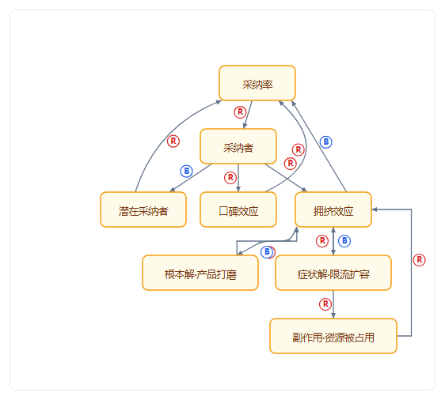
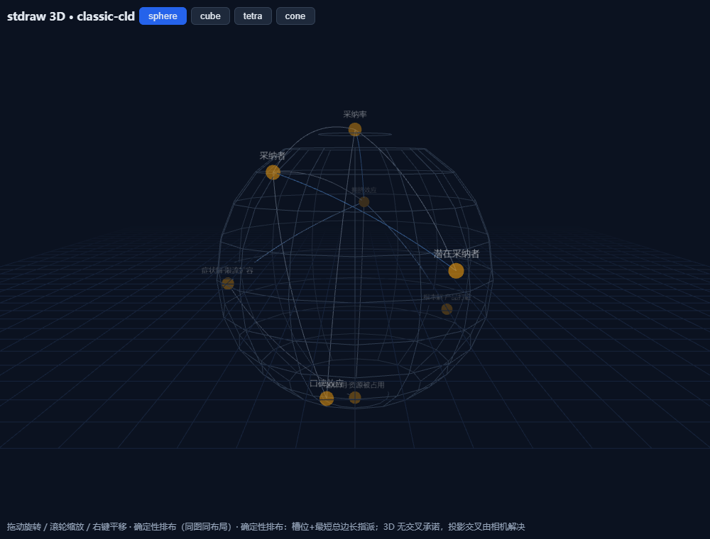
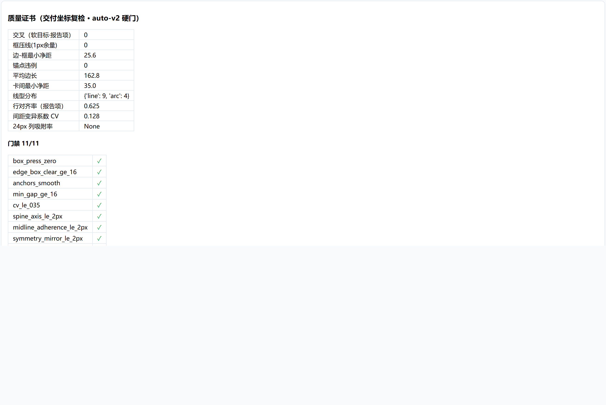
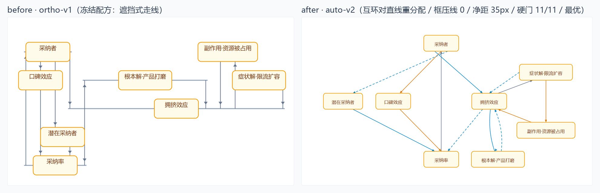

<div align="center">

# stdraw

**Planarity-aware system-thinking (CLD) diagram engine. Honest grades, hard quality gates, metric-backed certificates.**

*Text DSL in → diagram with a quality certificate out. Honest grades, never fake "zero crossings" claims.*

English | [简体中文](README_zh-CN.md)

</div>

[](https://github.com/jacky510/stdraw/actions/workflows/ci.yml)
[](LICENSE)
[](pyproject.toml)
[](https://github.com/jacky510/stdraw/stargazers)

[Install](#install) · [Gallery](#gallery) · [Quickstart](#quickstart) · [DSL](#dsl-in-one-minute) · [Certificates](#certificates--quality-gates) · [Agent Integration](#agent-integration)

```bash
pip install stdraw
```

---

## What & Why

Mainstream diagram tools stop at "crossing minimization" heuristics, and **none of them make a verifiable promise about their own output**. stdraw is built the other way around:

- **auto-v2 (default recipe)**: layered layout with crossings as a first-class term of the objective function (optional CP-SAT refinement) plus straight/arc-first routing, enforced by **hard quality gates**: box-over-line = 0 (any angle), edge-to-box clearance ≥ 16px, smooth border anchors, and symmetric/regular arrangement for simple graphs (≤ 10 nodes);
- **WS3 routing math**: detours are **provably shortest** — obstacles inflated by the clearance, then an exact Dijkstra shortest path over the corner visibility graph (graph-optimal); polyline corners are smoothed with tangent circular arcs (G1-continuous, bounded curvature, per-arc clearance re-verified); crossings are re-checked in **dual calibers** — the router's theoretical count on final geometry must equal the geometric recount on delivered coordinates, or no certificate is issued; R/B polarity markers are placed deterministically along the local tangent, never covering text or other wires;
- **ortho-v1 (classic recipe, optional)**: planar embedding + st-numbering + visibility representation — all wires strictly vertical with a **theorem-level 0-crossing guarantee** on planar graphs (behavior frozen, byte-regression protected, safe for production callers to pin);
- **Honest grading**: if it can't earn a certificate it says so — **never claims 0 crossings for arbitrary graphs** (in auto-v2, crossings are minimized, not guaranteed);
- **Two-layer ground-truth box measurement**: the layout side plans box bounds from worst-case real-font metrics; the verification side measures actual DOM bounds in a real browser after rendering — certificates verify rendered reality, not estimates;
- **Quality certificates**: every deliverable ships with quantified metrics (crossings / box-over-line / clearance / alignment / CV / anchors), verified on the delivered coordinates;
- **Determinism**: same input → same output, byte-identical (CP-SAT pinned to a single worker + fixed seed); diagrams are safe to commit with clean diffs.

## Gallery

All images are real renderings produced by the current engine (v0.4.0) from the in-repo corpus — no mock-ups, no stale artifacts (click through to each demo).

| | |
|---|---|
| <a href="../demos/classic-cld-2d.html"></a> | <a href="../demos/classic-cld-3d.html"></a> |
| **2D · auto-v2 hard-gate layout** (limits-to-growth × shifting-the-burden, 8n/13e, straight/arc lines, no box over a line) | **3D · sphere arrangement** (rotate freely; projection crossings solved by the camera) |
| <a href="../demos/classic-cld-2d.html"></a> | <a href="../demos/classic-cld-2d.html"></a> |
| **Quality certificate panel** (hard gates + gate tally + honest grade, exactly as shipped in the demo) | **Before/after** (same input, both rendered by the current engine: frozen ortho-v1 recipe with wires occluded under cards → auto-v2 hard-gate layout, gates 9/10, R/B polarity markers) |

## Ask your agent in plain words

stdraw is agent-native: one `.cld` text file in, a certified diagram out. Tell your agent:

| You say | The agent runs |
|---|---|
| "Draw this causal-loop diagram with a quality certificate" | `stdraw layout model.cld --outdir out` |
| "Audit the declared feedback loops: unclosed loops? wrong polarity?" | reads `out/loops_audit.json` → `problems` (loops re-enumerated independently) |
| "Can this diagram be zero-crossing? Tell me straight, no bragging" | reads `out/certificate.json` → `grade` (honest grading, below) |
| "Give me a printable version" | opens `out/demo-2d.html` (inline SVG, zero network) |

## Project Structure

```text
stdraw/
├── stdraw/              # Python package
│   ├── recipes.py       #   recipe registry: auto-v2 (default) / ortho-v1 (frozen, pin-safe)
│   ├── layout_auto.py   #   auto-v2 layout (layering + crossings-in-objective + optional CP-SAT + local refinement)
│   ├── routing.py       #   straight/arc/detour routing (box-over-line=0, clearance>=16px hard gates)
│   ├── textmetrics.py   #   ground-truth box bounds (layout side: worst-case real-font metrics)
│   ├── rendercheck.py   #   ground-truth box bounds (CI side: headless-browser DOM measurement, optional layer)
│   ├── visibility.py    # WS3: 布线数学（膨胀障碍可见性图最短路 + 弧平滑）
│   ├── crossing_exact.py  # WS2: 精确交叉数层（OIL 插入 ILP + 平面化 oracle + B&B 夹逼，可选 ortools）
│   ├── regularity.py    # WS2: 结构检测 + 规律性可计算定义（正多边形偏差/直线度/对称轴）
│   ├── placement.py     # WS2: 槽位离散化放置（结构驱动槽型；general 分支 CP-SAT）
│   ├── planar.py        #   ortho-v1: 2D planar layout (theorem-level 0 crossings, frozen behavior)
│   ├── layout3d.py      #   3D five-solid arrangements (sphere/cube/tetrahedron/cone)
│   ├── metrics.py       #   quality certificates v1/v2 + honest grading
│   ├── check.py         #   geometry self-checks (CI-gate form: v1 11 checks / v2 hard-gate checks)
│   ├── loops.py         #   loop-semantics audit (lint)
│   ├── dsl.py           #   .cld DSL parser
│   ├── model.py         #   graph data model
│   ├── render.py        #   2D HTML rendering (inline SVG, v1/v2 forms)
│   ├── render3d.py      #   3D HTML rendering (three.js)
│   └── __main__.py      #   CLI: stdraw layout ... [--recipe auto|ortho] [--linestyle straight|arc]
├── examples/            # .cld cases (limits-to-growth / limits-to-growth × shifting-the-burden)
├── demos/               # deliverable form: 2D/3D demos + certificate JSON
├── viewer/              # zero-dependency interactive viewer (four forms + live certificate)
├── skills/stdraw/       # Agent Skill (installable via skills add)
├── tests/baselines/     # ortho-v1 byte-regression baselines (frozen-behavior iron gate)
├── docs/                # DSL spec + gallery + OR-Tools comparison + crossing-exact math (WS2)
└── .github/workflows/   # CI: recipe regression + hard gates + DOM measurement + determinism
```

## Quickstart

```bash
# 1. Install (pure pip; the only hard dependency is networkx)
pip install stdraw

# 2. Run a case: text DSL in
stdraw layout examples/limits-to-growth.cld --outdir out --pitch 62

# 3. Look at the deliverables
#    out/demo-2d.html     — 2D layout + embedded quality certificate
#    out/demo-3d.html     — 3D sphere/cube/tetrahedron/cone (needs the in-repo assets/)
#    out/certificate.json — metrics + honest grade
#    out/loops_audit.json — loop-semantics audit
```

A ready-made deliverable ships in the repo: open [`demos/classic-cld-2d.html`](demos/classic-cld-2d.html) / [`demos/classic-cld-3d.html`](demos/classic-cld-3d.html).
Interactive viewer (four forms + node dragging + loop panel): open `viewer/index.html` in a browser, nothing to install.

## DSL in One Minute

Line-oriented text, `#` starts a comment:

```ld
graph "limits-to-growth × shifting-the-burden"
var rate "adoption rate"
rate -> + adopters @loops R1,B1,B2      # polarity edge + loop tags
loop R1 "word of mouth" "R" [rate, adopters, word]
```

A minimal closed loop = variables / polarity edges / loop tags / groups (optional; the layout
layer does not consume groups — layout is determined by relations alone). Loop tags are not
comments — the lint layer verifies closure and R/B polarity parity against an independent
enumeration of all loops. Full spec: [docs/dsl-spec-v0.1.md](docs/dsl-spec-v0.1.md)
(a Chinese translation is planned; no date promised).

## Certificates · Quality Gates

Every deliverable directory contains `certificate.json`:

```json
{
  "metrics": { "crossings": 1, "box_press_1px": 0, "edge_box_min_clear": 18.0,
               "min_card_gap": 22.0, "row_align_rate": 0.625,
               "spacing_cv": 0.162, "column_snap24_rate": 1.0,
               "mutual_pair_min_sep": 12.0 },
  "gates":   { "crossings_zero": false, "box_press_zero": true,
               "edge_box_clear_ge_16": true, "anchors_smooth": true,
               "min_gap_ge_16": true, "row_align_ge_060": true,
               "cv_le_035": true, "regularity_simple": true,
               "mutual_pairs_separated": true, "routing_consistent": true },
  "grade": "其次"
}
```

Honest grading semantics (iron rule: **never pass off a non-certificate as one**):

| Grade | Definition (auto-v2) |
|---|---|
| **最优** (best) | all hard gates pass (box-over-line 0 / clearance ≥ 16 / smooth anchors / regular arrangement) + 0 crossings |
| **其次** (second) | all hard gates pass + ≤ 2 crossings (coords in the certificate for review; when gates and crossings conflict, gates win) |
| **最次** (3D) | dimension-lift to 3D: rotate freely, no spatial crossings, projection crossings solved by the camera |
| **未获证书** (uncertified) | everything else — honestly ungraded |

`geometry_report.json` (geometry self-checks in CI-gate form; the CLI exits 1 on fail) can be used directly as a regression gate.

**Exactness layer (WS2, `--exact`)**: the CLI can compute the provable crossing
number cr(G) (ordering-style insertion ILP + planarization oracle + exhaustive
B&B over planar subgraphs × embeddings). The certificate then carries
`proven_optimal` / `gap` / `lb` / `crossing_number` in an `exactness` block —
with a rigorous scope note: optimality is claimed only relative to the model
class defined in [docs/crossing-exact.md](docs/crossing-exact.md) §0–5, never
over all conceivable metric sets. Requires the optional solver extra
(`pip install "stdraw[solver]"`); without it the fields honestly stay
`computed: false`. Layouts also carry a computable **regularity** block
(structure-driven: cycle → regular-polygon deviation, chain → straightness,
symmetry-axis alignment; definitions in docs/crossing-exact.md §7).

### Recipes

| Recipe | Line style | Guarantee | Use when |
|---|---|---|---|
| `auto-v2` (default) | straight/arc first-class (`--linestyle straight\|arc`) | hard quality gates + crossing minimization (optional CP-SAT via `pip install "stdraw[solver]"`) | general CLDs / teaching / reports |
| `ortho-v1` (`--recipe ortho`) | all-vertical orthogonal | theorem-level 0 crossings on planar graphs (**frozen behavior**, byte-regression in CI) | production callers pinning behavior / orthogonal style preference |

## Agent Integration

| Agent host | Integration |
|---|---|
| Any agent that can read files | read [AGENTS.md](AGENTS.md) (repo root, agent manual, English) |
| Agent Skills ecosystem | `npx skills add jacky510/stdraw` → installs [skills/stdraw/SKILL.md](skills/stdraw/SKILL.md) (English) |
| Scripts / CI gates | `pip install stdraw` → `stdraw layout ...` → assert on `certificate.json` / `geometry_report.json` |
| MCP server | planned (see the placeholder in AGENTS.md) |

## Limitations (honest boundaries)

- **Never claims 0 crossings for arbitrary graphs**: in auto-v2, crossings are a minimized objective term, not a theorem guarantee; ortho-v1 raises `NotPlanarError` on non-planar input and degrades honestly instead of forcing a drawing.
- ortho-v1 (frozen recipe) allows "unrelated wires occluded under cards" as legacy design (cards are opaque) and counts it honestly in the certificate — a known v0.1 boundary; **the v0.2 default recipe auto-v2 makes box-over-line a hard gate (= 0)**.
- The 3D layer makes no 2D crossing promises — spatial chords don't intersect thanks to the extra dimension; projection crossings are solved by the camera.
- The layout layer is a replaceable implementation (currently: layering + crossing minimization + straight/arc routing; CP-SAT is an optional refinement layer — without it the engine degrades to the constructive method: full features, construct-tier quality).
- The local-search neighborhood covers in-row shifts and adjacent swaps, not cross-row moves — the last crossing of some graphs may need a larger neighborhood (roadmap M3).

## License

[MIT](LICENSE) © stdraw contributors
