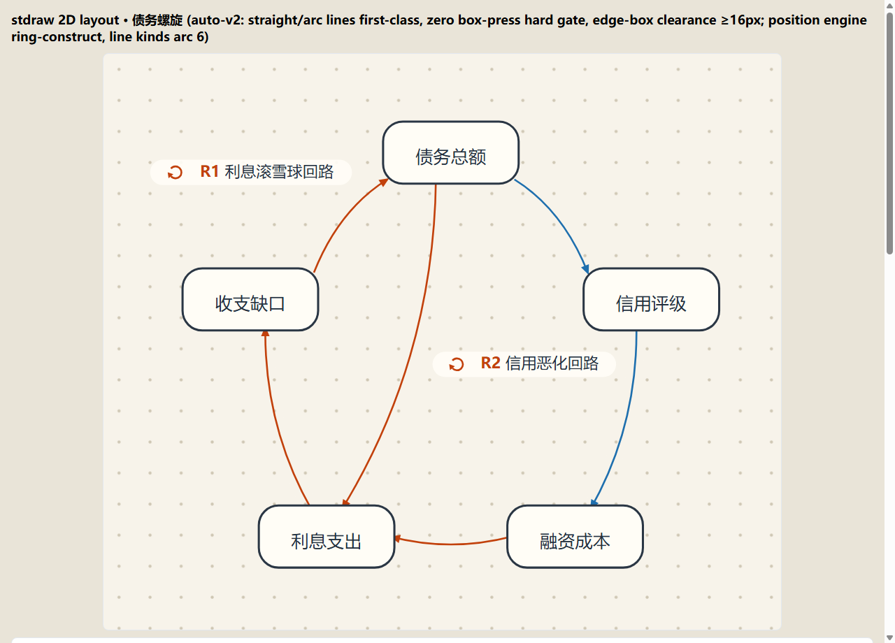
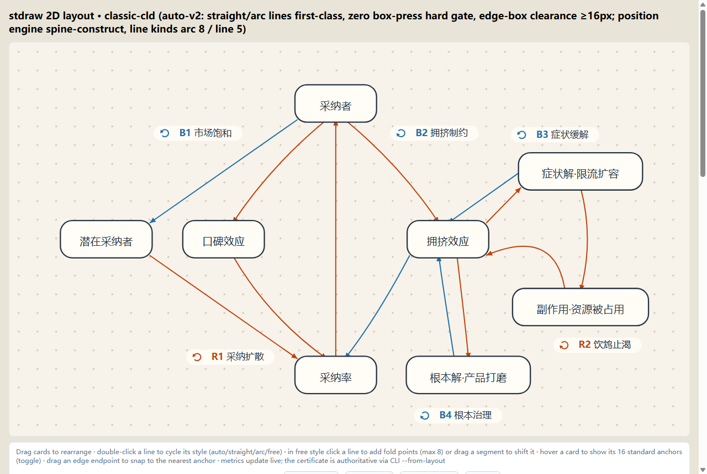
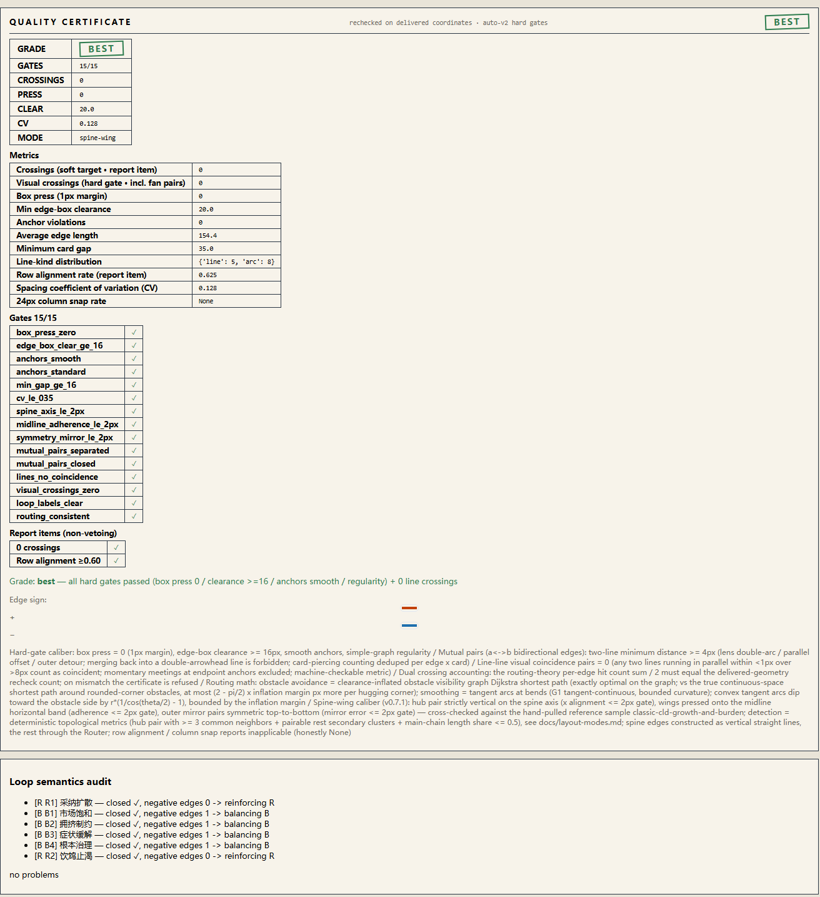

<div align="center">

# stdraw

**Planarity-aware 系统思维图引擎。诚实分级、硬质量门、带量化证书的交付。**

*Text DSL 进 → 带质量证书的图出。诚实分级，绝不冒充「零交叉」。*

**规模预期，开门见山：推荐 ≤10 节点 · classic 配方均值 ~10 秒/张（graphviz-dot 0.03 秒——慢 2~3 个数量级是刻意取舍：用速度换硬质量门 + 机器可读证书）· n≥50 不推荐。** 数据：[benchmarks/REPORT.md](benchmarks/REPORT.md)

[English](README.md) | 简体中文

</div>

[](https://github.com/jacky510/stdraw/actions/workflows/ci.yml)
[](LICENSE)
[](pyproject.toml)
[](https://github.com/jacky510/stdraw/stargazers)

[安装](#安装) · [图例](#图例) · [上手指南](#上手指南) · [DSL](#dsl-一分钟) · [证书与质量门](#证书与质量门) · [Agent 集成](#agent-集成)

```bash
pip install stdraw
```

> 面向 agent host 的机器消费文档（[AGENTS.md](AGENTS.md)、[skills/stdraw/SKILL.md](skills/stdraw/SKILL.md)）以英文为准；DSL 规范双语对照：[中文版](docs/dsl-spec-v0.1.zh-CN.md) / [英文正本](docs/dsl-spec-v0.1.md)。

---

## 是什么与为什么

主流图工具全停在「交叉最小化」启发式，并且**没有一个敢对自己的输出做承诺**。stdraw 反过来：

- **auto-v2（默认配方）**：**按结构选模式的模式化排布**——确定性优先级链（领结对对称 → 领结共点 → 纵柱+翼位 → 双侧梳状 → 纵列 → 环形 → 透镜链 → 分层）按图结构选一个排布模板，每个模式带试验闸门（不触发的图逐字节不变）+ 直线/弧线一等布线（CP-SAT 精化可选），带**硬质量门**：框压线=0（任何角度）、边-框净距≥16px、锚点平滑、按模式切换的规律门——详见 [docs/layout-modes.md](docs/layout-modes.md)；
- **回路识读层**：每个已声明回路带**回路中心标识**（编号 + 名称 + 方向符号；极性仍只用颜色——标识上不加 +/−），默认显示，demo 页 `Loops: on/off` 可关；属于 ≥3 节点回路的边默认画**顺回路弧线**——顺着所在回路弯、背向回路质心鼓出，回路读起来成一个环——直线 / 绕行折线是带评分的兜底，实测原因写入 `certificate.json` → `loop_arcs.fallbacks`；`a -> + b @delay` 在边中点画双短线延迟标记（`graph.cld` 往返一致）。标识与刻线纳入硬门（`loop_labels_clear`、`delay_marks_clear`：不压框、不压线、标识互不重叠）；整个标识层（标签 + 延迟标记，同一开关）渲染时可用 `--no-loop-labels` 关掉——此时证书把这两道门如实记为 `N/A`（grade 语义不变）。demo 页标题与 CLI 摘要印的是**交付**线型分布（`metrics.line_kind_counts`），不是 `--linestyle` 的请求值——口径：[docs/grading-contract.md](docs/grading-contract.md) 附录 B 与 [docs/edge-placement-rules-v1.md](docs/edge-placement-rules-v1.md) §20；
- **回路主导小图环形排布（v0.5.0）**：小图（≤12 节点）存在覆盖 ≥ n−2 节点的主环（或环边占比 ≥90%）时，主环按环序上**正多边形环槽位**（优先声明环序——R/B 极性着色沿环可读）、弦走环内、残节点确定性环内/环外指派；证书切换为**环形口径指标**（环上等间距 CV + 正多边形模板拟合误差），不再拿行对齐门槛误判环形排布；不触发的图保持分层路径逐字节不变；
- **锚点带内硬门（v0.7.3）**：交付锚点带内口径（边中点 ±1/4 带、转角命中恒 0）落进 CI 逐图硬门——spine-wing 图须 100% 带内；互环对带内钳制过不了硬门时走确定性带内局部重定线（带内锚候选 + 嵌套弧逃生门 + 自家框内部检查）；其余引擎锁 v0.7.2 基线比例（ring 互环走廊 / bowtie ±12px 辐条走廊为在册遗留）——详见 [docs/layout-modes.md](docs/layout-modes.md)；
- **布局美学 v3.1（v0.7.1，jacky 手拉样本定调）**：**纵柱+翼位模式（spine-wing）**——存在「中枢对」（某条边的两端点共享 ≥3 个公共邻居，构成中线翼位带）且次级簇可镜像配对的图（如 classic-cld 增长极限×转嫁负担，以 jacky 手拉布局为基准）走**纵柱+中线翼位排布**——中枢对严格垂直居轴、翼位压水平中线、翼外镜像对上下对称；确定性触发判定（中枢对公共邻居数 + rest 簇可配对 + 主链长度占比 ≤0.5），等价证书门（纵柱 x 对齐 ≤2px / 中线贴靠 ≤2px / 镜像 ≤2px）；语料 sweep 仅 classic-cld 一张切换，其余 18 张逐字节零漂移——详见 [docs/layout-modes.md](docs/layout-modes.md)；
- **布局美学 v3（v0.7.0，jacky 手拉样本定调）**：**领结共点模式（bowtie-vertex）**——拓扑恰为「两个简单环共享一个节点」的图（如通胀工资螺旋，以 jacky 手拉布局为基准）走**双轴镜像排布**——共享节点居画布正中心、两环各占上下半平面、镜像行对称，全直线布线（互环辐条走 ±12px 平行双线走廊）；**线-框连接点口径收紧**——锚点钳制到每条边中点 ±1/4 边长带内（转角整体排除、命中数恒 0），同节点同侧多线按入射角在中点两侧对称展开；**弧度参数化**——鼓出 = min(6 + 0.06·弦长, 40) px（短边小弯、长边封顶），同一对称结构内弧度统一档——详见 [docs/layout-modes.md](docs/layout-modes.md)；
- **布局美学 v2（v0.6.0，jacky 全图定调「规律优先」）**：长链/少环图（主环 ≤4）走**纵列排布**——主链纵向对齐一列、支路挂近邻侧列、主链闭合边构造为左侧大弧（圆环感）；领结图（双三角共边，如学习飞轮）走**镜像对称排布**（共享边居纵轴 + 左右顶点镜像，线型一致硬规则：轴边直线 + 侧边全弧）；回路边**按极性着色**（UI-A 浅色档 R=朱红 `#c2410c`、B=制图蓝 `#1e6fae`，深色档 `#ffb454`/`#6ec6ff`，唯一出处 `stdraw/themes.py`；多环异色/非环边中性灰，负极性虚线），替代 R/B 文字徽标；**同构骨架 → 同布局模板**（WL 结构色驱动槽位指派，不依赖声明环 id）；交叉与行对齐从硬门降为**报告项软目标**（秩序与优美优先），排布规律类仍为硬门——详见 [docs/layout-modes.md](docs/layout-modes.md)；
- **WS3 布线数学**：绕障是**可证最短**——障碍按净距膨胀后，在角点可见性图上跑精确 Dijkstra 最短路（图上最优）；折角以相切圆弧平滑（G1 切线连续、曲率有界、逐弧净距复核）；交叉按**双口径**复检——路由理论口径（最终路线）必须等于交付坐标几何复检，不一致拒发证书；R/B 极性标记随局部切线确定性放置，不遮字不压线；
- **D0 禁令（2026-11-11，现行有效）**：全竖直正交图禁止作为交付物 / 发布物 / iframe 嵌入 / 画廊截图——方框压线 / 引线杆遮挡是全竖直表示的结构性产物；原 ortho 配方的对外入口已于 2026-11-24 移除，扫描器 `scripts/check_no_ortho_delivery.py` 继续作为交付出口门禁，见 [docs/grading-contract.md](docs/grading-contract.md) §4；
- **诚实分级**：拿不到证书就如实说拿不到——**绝不宣称任意图 0 交叉**（auto-v2 的交叉数是目标函数最小化项，不是定理保证）；
- **框界真值两层验证**：布局侧按真实字体最坏度量规划框界；验证侧在真实渲染后量 DOM 实际框界——证书量的是渲染真值，不是估算值；
- **质量证书**：每一次交付都带量化证书（交叉 / 框压线 / 净距 / 对齐 / CV / 锚点），验证跑在交付坐标上；
- **确定性**：同输入同输出，逐字节一致（CP-SAT 固定单 worker + 种子），图进版本库 diff 干净。

### 适用规模（推荐 ≤ 10 结点，诚实边界）

**推荐不超过 10 个结点**——这是「CP-SAT 证到最优 + `_polish` 全套打磨 + 硬质量门全过」的实测边界（经典 CLD 小图域，n10 约 45–60s/张）。≤12 结点可触发环形排布（回路主导小图）。n=20–30 修复后能出图（随机稀疏族 n20/n30 出图率 20/20），但定位从「证最优」降级为「确定性预算内 incumbent」，框压线/净距不再保证为 0，运行时间比基线慢 2~3 个数量级；n≥50 不建议（n50 出图 19/20，正交配方对非平面输入诚实跳过）。数字以 [benchmarks/REPORT.md](benchmarks/REPORT.md) §4/§5 为准。

## 图例

全部为当前引擎（v0.9.0）对仓内语料的真实渲染截图——非手改、非旧版残留（点击跳转对应 demo）。

<table>
  <tr>
    <td><a href="demos/debt-spiral-2d.html"></a></td>
    <td><a href="demos/classic-cld-2d.html"></a></td>
  </tr>
  <tr>
    <td><strong>2D · auto-v2 环形布局</strong>（债务螺旋，5n/6e，教科书级债务螺旋反馈环画成一个干净的环——0 交叉、卡间距 75.6px；边按符号双色：+ 朱红 / − 制图蓝，全实线；回路标识 R1 / R2 居回路中心，6 条回路边全部沿环弧线）</td>
    <td><strong>2D · auto-v2 纵柱+翼位布局</strong>（经典 CLD 增长与负担，8n/13e，中枢对严格垂直居轴 + 翼位压水平中线 + 翼外镜像对称——0 交叉、卡间距 35.0px；边按符号双色：+ 朱红 / − 制图蓝，全实线；回路标识 R1 / B1–B4 / R2 居回路中心）</td>
  </tr>
  <tr>
    <td colspan="2" align="center"><a href="demos/classic-cld-2d.html"></a></td>
  </tr>
  <tr>
    <td colspan="2" align="center"><strong>质量证书面板</strong>（硬门 + 门禁 + 诚实分级，随 demo 交付；纵柱翼位口径：纵柱轴偏差/中线贴靠/镜像误差）</td>
  </tr>
</table>

## 对 agent 说人话

stdraw 是 agent 原生工具：一份 `.cld` 文本进，带证书的图出。你可以直接对 agent 说：

| 你说 | agent 跑 |
|---|---|
| 「帮我把这张因果回路图画出来，要带质量证书」 | `stdraw layout model.cld --outdir out` |
| 「审计这个文件里声明的反馈环：有没有不闭合的、极性标错的？」 | 看 `out/loops_audit.json` 的 `problems`（独立枚举全图回路对照） |
| 「这张图能零交叉吗？拿不到就直说，别吹」 | 看 `out/certificate.json` 的 `grade`（诚实分级，见下） |
| 「给一张能打印的版本」 | 打开 `out/demo-2d.html`（内联 SVG，零联网） |

## 项目结构

```text
stdraw/
├── stdraw/              # Python 包
│   ├── recipes.py       #   配方注册表：auto-v2（默认）/ candidate-v1（可选）
│   ├── layout_auto.py   #   auto-v2 布局（分层 + 交叉进目标 + CP-SAT 可选精化 + 局部精化）
│   ├── routing.py       #   直线/弧线/绕行布线（框不压线、净距≥16px 硬门）
│   ├── textmetrics.py   #   框界真值（布局侧：真实字体最坏度量）
│   ├── rendercheck.py   #   框界真值（CI 侧：无头浏览器 DOM 实测，可选层）
│   ├── visibility.py    # WS3：布线数学（膨胀障碍可见性图最短路 + 弧平滑）
│   ├── crossing_exact.py  # WS2：精确交叉数层（OIL 插入 ILP + 平面化 oracle + B&B 夹逼，可选 ortools）
│   ├── regularity.py    # WS2：结构检测 + 规律性可计算定义（正多边形偏差/直线度/对称轴）
│   ├── placement.py     # WS2：槽位离散化放置（结构驱动槽型；general 分支 CP-SAT）
│   ├── ringlayout.py    # v0.5.0：回路主导环形排布（触发判定 + 主环正多边形槽位 + 残节点指派）
│   ├── columnlayout.py  # v0.6.0：纵列排布（长链/少环：主链一列 + 支路侧挂 + 闭合侧弧）
│   ├── symlayout.py     # v0.6.0：领结对对称排布（双三角共边：纵轴镜像 + 线型一致）
│   ├── planar.py        #   内部平面模块（candidate_planar.py 依赖；非配方）
│   ├── metrics.py       #   质量证书 + 诚实分级
│   ├── check.py         #   几何自检（CI 门禁形态：硬门检查）
│   ├── loops.py         #   环路语义审计（lint）
│   ├── dsl.py           #   .cld DSL 解析器
│   ├── model.py         #   图数据模型
│   ├── render.py        #   2D HTML 渲染（内联 SVG，v1/v2 双形态）
│   └── __main__.py      #   CLI：stdraw layout ... [--recipe auto|candidate-v1] [--linestyle straight|arc] [--no-loop-labels]
├── examples/            # .cld 案例（增长极限 / 增长极限×转嫁负担）
├── demos/               # 交付形态：2D demo + 证书 JSON
├── skills/stdraw/       # Agent Skill（skills add 即装）
├── docs/                # DSL 规范 + gallery + OR-Tools 对比 + 精确交叉数数学（WS2）
└── .github/workflows/   # CI：新硬门 + DOM 实测 + 确定性
```

## 上手指南

```bash
# 1. 安装（纯 pip，唯一硬依赖 networkx）
pip install stdraw

# 2. 跑一个案例：文本 DSL 进
stdraw layout examples/limits-to-growth.cld --outdir out --pitch 62

# 3. 看交付形态
#    out/demo-2d.html     — 2D 布局 + 内嵌质量证书
#    out/certificate.json — 指标 + 诚实分级
#    out/loops_audit.json — 环路语义审计
```

仓库内已有跑好的交付形态：直接打开 [`demos/classic-cld-2d.html`](demos/classic-cld-2d.html)。

### 手动微调闭环（拖拽 → 导出 → 复算证书）

微调层走 `--interactive` 显式 opt-in（CLI 默认输出=静态图+证书，不带交互层）：
拖卡片（鼠标/触摸），顶栏指标实时复算，然后：

```bash
stdraw layout input.cld --outdir out --interactive
# 1. 打开 out/demo-2d.html，拖动卡片，点「Export layout（导出布局）」按钮
#    -> 下载 graph-manual-layout.json（layout.json 兼容子集）

# 2. 按你的坐标重跑布线+证书——硬门口径不变、如实评分
#    （手动布局绝不因「是人排的」就放水）：
stdraw layout input.cld --outdir out-manual --from-layout graph-manual-layout.json

# 3. （可选）auto vs manual 双证书对照（差距即引擎与人的审美距离）
#    ——仓内开发量具，不随安装包发布：
python tools/compare_auto.py input.cld \
    --from-layout graph-manual-layout.json --outdir out-manual

# 4. 三层 diff（节点位移 / 结构指标 / 回路语义）——从人工编辑里
#    归纳审美规律的数据源（仓内开发量具，不随安装包发布）：
python tools/layoutdiff.py out/layout.json out-manual/layout.json --cld input.cld --out diff.json
```

### 折点把手（绕障折点可拖，不再固定死）

v0.5.3 起微调层（`--interactive` 页面）在拖拽期间对**全部线型实时重布线**（直线/弧线/可见性图折线一视同
仁——折点逐帧按当前障碍重算，不再有钉死的中间点）。绕障折线的每个折点渲
染为小圆把手（hover 显示 move 光标）：

- 拖动把手 → 该边转为「用户锚定」；此后拖节点只重锚端点，你的折点保真；
- 「Export layout（导出布局）」对锚定边写出 `edges: [{a, b, waypoints: [[x,y],...]}]`；
  `--from-layout` 按同口径复算（锚点=框边朝向首/末 waypoint 重算），证书
  几何复检如实包含你的 waypoints，不放水；
- 「Reset（重置）」清除全部锚定并还原引擎布局。

```bash
# 拖完把手并导出后：
stdraw layout input.cld --outdir out-manual --from-layout graph-manual-layout.json
# layout.json 中该边 route.kind = "waypoints"，via = 你的折点
```

### 线型控制与手动微调（v0.7.7）

自动线型规则：**回路边默认弧线**——属于某个 ≥3 节点已声明回路的边顺着
所在回路弯（背向回路质心鼓出，回路读起来成一个环）；**直线 / 绕行折线
只作兜底**，仅当首选弧线不可交付（压框、净距、锚角）时启用，每条兜底都
把实测原因写进 `certificate.json` → `loop_arcs.fallbacks`。不属于任何回路
的边仍默认直线；互指对始终走透镜双弧走廊，模式特化美学照旧（如
spine-wing 中线弧）。双侧供应链图（K_{m,2}：每个源点都连向两个不相
邻 hub）进入新的 **comb-bilateral（双侧梳状）**排布——源点单竖列、
双 hub 左右镜像槽位、hub 边全直线扇形。

demo 页上的逐边手动控制：

- **双击线**循环切换线型 `auto → straight → arc → free → auto`
  （≥10px hover 命中区、pointer 光标 + 高亮；与节点拖拽互不干扰）。
  forced 状态下实时重布线，顶栏指标如实复算——硬门失败显红，不放水；
- **free（自由）态**：单击线上任意点插入折点把手并拖拽——用户段为
  **精确折线**（WYSIWYG 不平滑），锚点按框边朝首/末折点重算。每边
  **最多 3 个折点**；到顶后单击改为选最近把手，tooltip 提示
  "max 3 points per edge"；
- **Export layout（导出布局）** 同时写出 `edges[].style`（free 折点以
  `waypoints` 随行）；`--from-layout` 按同一确定性规则回放
  straight/arc/free，证书几何复检如实；
- **Reset（重置）** 清 pins + styles + 折点，回到引擎默认态。

给嵌入页的两个集成钩子：

```js
// 程序化套用一个布局（「Export layout」的逆操作）
window.__stdrawApplyLayout({
  nodes: {id: {x: 100, y: 200}},
  edge_styles: {"a->b": "arc"},          // auto | straight | arc | free
  waypoints: {"a->b": [[300, 240]]}      // free 折点（上限 3）
});
// 用事件代替 pointerup 轮询
window.addEventListener("stdraw:layoutchanged", e => {
  // e.detail = 当前布局（nodes + 带样式的 edges + waypoints）
});
```

第二行长文本（股票代码 / 价格串）超出计划卡宽时，`--value-pad PX`
为值行保留额外单侧余量（进程内对应 `AutoConfig.value_pad_extra`；
默认保持历史尺寸，逐字节不变）。

## DSL 一分钟

行导向文本，`#` 起注释：

```ld
graph "增长极限×转嫁负担"
var rate "采纳率"
rate -> + adopters @loops R1,B1,B2      # 极性边 + 回路标签
loop R1 "采纳扩散" "R" [rate, adopters, word]
```

最小闭环 = 变量 / 极性边 / 回路标签 / 分组（可选，布局层不消费分组——布局由关系唯一决定）。
回路标签不是注释——lint 层验证闭合性与 R/B 极性奇偶，独立枚举全图回路对照（抓过「声明环不闭合」「极性标错」）。
规范全文：[docs/dsl-spec-v0.1.zh-CN.md](docs/dsl-spec-v0.1.zh-CN.md)（[英文正本](docs/dsl-spec-v0.1.md)）。

可选的 `@delay` 标在边行上表示延迟——边中点画双短线（与回路标识同受硬门约束）：
`rate -> + adopters @loops R1 @delay`；`graph.cld` 往返一致。

## 证书与质量门

每个交付目录里的 `certificate.json`：

```json
{
  "metrics": { "crossings": 0, "box_press_1px": 0, "edge_box_min_clear": 18.0,
               "min_card_gap": 36.0, "row_align_rate": null,
               "spacing_cv": 0.0, "column_axis_deviation": 0.0,
               "loop_cohesion_spread": { "R1": 0.43, "B1": 0.43 },
               "line_kind_counts": { "line": 5, "arc": 1 } },
  "gates":   { "box_press_zero": true, "edge_box_clear_ge_16": true,
               "anchors_smooth": true, "min_gap_ge_16": true,
               "cv_le_035": true, "column_axis_aligned": true,
               "spine_pitch_uniform": true,
               "mutual_pairs_separated": true, "routing_consistent": true,
               "lines_no_coincidence": true },
  "reports": { "crossings_zero": true,
               "crossings_note": "soft target: <=2 crossings allowed when placement regularity holds (order and elegance come first)",
               "row_align_ge_060": true },
  "placement": "column-chain",
  "grade": "best"
}
```

（v0.6.0 起：纵列/对称各有模式口径门；交叉与行对齐降为报告项软目标，见 docs/layout-modes.md。环形排布证书：行对齐率/列吸附如实为 `null`——规律性门按排布模式切换为
环上等间距 CV + 正多边形模板拟合误差；分层布局仍用行对齐口径。）

**n > 10 图（jacky 2026-11-26 裁定，stdraw20 人工校准）**：三道机械网格规律性门
——`cv_le_035` / `pitch_uniform`（含 `spine_pitch_uniform` / `column_pitch_uniform`
别名）/ `column_snap24_ge_060`——降级为**报告项**：实测布尔值移入 `reports`
（同名键 + `regularity_demoted_note`），`gates_passed` 不再计入，也不再阻断评级。
底层指标行（`spacing_cv` / `column_snap24_rate` 等）照旧实测。n ≤ 10 图（推荐档）
三门仍是硬门，逐字节不变。

**人工图（`--from-layout`，jacky 2026-11-27 裁定）**：手画布局不是机械网格，因此
`cv_le_035` 对人工回放**永不做硬门**——按 n > 10 自动口径同样的方式降为报告项，
其 `regularity_demoted_note` 明写人工口径。`pitch_uniform` / `column_snap24_ge_060`
保留 P1-2 的 `N/A` 槽位；自动管线（n ≤ 10 与 n > 10）全不变。

诚实分级语义（分级铁律：**绝不冒充成品**）：

| 级别（token） | 定义（auto-v2） |
|---|---|
| **`best`（最优）** | 硬门全过（框压线 0 / 边-框净距≥16 / 锚点平滑 / 规律排布）+ 线 0 交叉 |
| **`uncertified`（未获证书）** | 其余情况——如实不评级 |

分级语义单一事实源：[docs/grading-contract.md](docs/grading-contract.md)——auto-v2（caliber `v2-hardgates`）只产出 `best` / `uncertified` 两档（`second` 已于 v0.7.15+ 从 v2 实现移除；仍带该档的 v1-legacy 口径已于 2026-11-24 随配方入口一并退役）；交叉 ≤2 / 行对齐是布局软目标，不是证书门。

另有 `geometry_report.json`（几何自检，CI 门禁形态，fail>0 时 CLI exit 1）可直接当回归门禁用。

**精确交叉数层（WS2，`--exact`）**：CLI 可计算可证明的交叉数 cr(G)
（排序式插入 ILP + 平面化 oracle 裁决 + 可平面子图 × 全嵌入的 B&B 夹逼）。
证书随之携带 `exactness` 块的 `proven_optimal` / `gap` / `lb` / `crossing_number`
——并附严谨范围声明：最优性只相对 [docs/crossing-exact.md](docs/crossing-exact.md)
§0–5 定义的模型类成立，不虚称全体指标集。需要可选求解层
（`pip install "stdraw[solver]"`）；未装时字段如实 `computed: false`。
布局另附可计算**规律性**块（结构驱动：环图→正多边形偏差、链图→直线度、
对称轴对齐度；定义见 docs/crossing-exact.md §7）。

### 配方

| 配方 | 线型 | 保证 | 适用 |
|---|---|---|---|
| `auto-v2`（默认） | 直线/弧线一等（`--linestyle straight\|arc`） | 硬质量门 + 交叉最小化（CP-SAT 可选 `pip install "stdraw[solver]"`）；按结构选排布模式：环形（回路主导）/ 纵列（长链少环）/ 镜像对称（领结）/ 透镜链（纯二环图），各带模式口径规律门；回路边 R=朱红/B=制图蓝着色（浅色档）、负边虚线 | 一般 CLD / 教学 / 报告 |
| `candidate-v1`（`--recipe candidate-v1`） | 直线/弧线 | 候选池管线（结构分析 + 模板源 + 编排器），可选加入，带不差于 auto 护栏 | 实验 / 候选生成 |

## Agent 集成

**按结果选路径，别按本地先例抄。** 最常见的集成错误是拿 `layout.json` 的坐标自烤一张
静态 SVG——交付物随即退化：不可拖拽、无折叠点手柄、失去「导出→重算」闭环，也没有诚实
证书。坐标输出自带交付契约元数据（`stdraw/delivery.py`）：坐标-only 模式带
`"delivery": "coordinates-only"`、`"interactive": false`、`"engine_version"` 及一行
警告；CLI 全量交付时改标 `"delivery": "stdraw-cli"`，`"interactive"` 仅当页面带
拖拽微调层（CLI `--interactive`）才为 `true`——CLI 默认页为静态图、如实标注
`"interactive": false`。
`certificate.json` 新增交付面自白栏 `"interactive"` / `"drag_layer"`，宿主 CI 可直接
拿它做门禁：

| 你要什么 | 用什么 | 若仍走最后一行，失去什么 |
|---|---|---|
| 一张完成的图（证书） | `stdraw layout model.cld` → 交付 **`demo-2d.html`** | — |
| 一张可拖拽修饰的完成图 | `stdraw layout model.cld --interactive` → 交付 **`demo-2d.html`** | — |
| 把图嵌进自己的页面 | 内嵌 `demo-2d.html`（iframe；要修饰能力渲染时加 `--interactive`）+ 持久化导出布局 + `--from-layout`（见下） | — |
| 给自建渲染器喂坐标 | `layout.json`——自我声明坐标-only 并附警告；确要坐标可显式关警告：`recipes.run(..., suppress_delivery_warning=True)` | 实时拖拽重布线、折叠点手柄、导出→重算闭环、质量证书、CI 门禁 |

### 最小嵌入（官方姿势）

```html
<!-- 嵌交付页面，不是嵌坐标（要拖拽修饰能力，渲染时加 --interactive） -->
<iframe src="demo-2d.html" style="width:100%;height:820px;border:0"
        title="stdraw 图（可拖拽修饰）"></iframe>
```

```bash
# 在 --interactive 的 demo-2d.html 里手工修饰后："Export layout" -> manual-layout.json
stdraw layout model.cld --from-layout manual-layout.json --outdir out-manual
# -> 修饰后坐标上重渲染的 demo-2d.html + 重新评分的证书
```

| Agent host | 接入方式 |
|---|---|
| 任意能读文件的 agent | 读 [AGENTS.md](AGENTS.md)（仓根，agent 使用说明书，英文） |
| Agent Skills 生态 | `npx skills add jacky510/stdraw` → 安装 [skills/stdraw/SKILL.md](skills/stdraw/SKILL.md)（英文） |
| 脚本 / CI 门禁 | `pip install stdraw` → `stdraw layout ...` → 断言 `certificate.json` / `geometry_report.json` |
| MCP server | 规划中（见 AGENTS.md 预留位） |

## 局限（诚实边界）

- **绝不宣称任意图 0 交叉**：auto-v2 的交叉数是目标函数最小化项而非定理保证。
- 全竖直正交图的「无关线遮挡式穿卡」为 legacy 设计允许——**v0.2 起默认配方 auto-v2 已把框压线定为硬门（=0）**；且 **D0 禁令（2026-11-11）**：全竖直正交图「到处是方框压线、多次改不掉」，属结构性缺陷，**禁止作为交付物**（隔离而非修复），扫描器 `scripts/check_no_ortho_delivery.py` 已接入 CI。
- 布局层是可替换实现（当前：分层 + 交叉最小化 + 直线/弧线布线；CP-SAT 为可选精化层，未装时构造法降级，质量回退但功能齐全）。
- 局部搜索邻域为行内横移与相邻交换，不含跨行搬移——个别图的最后一处交叉可能需要更大邻域（路线图 M3）。

## 许可证（License）

[MIT](LICENSE) © stdraw contributors
