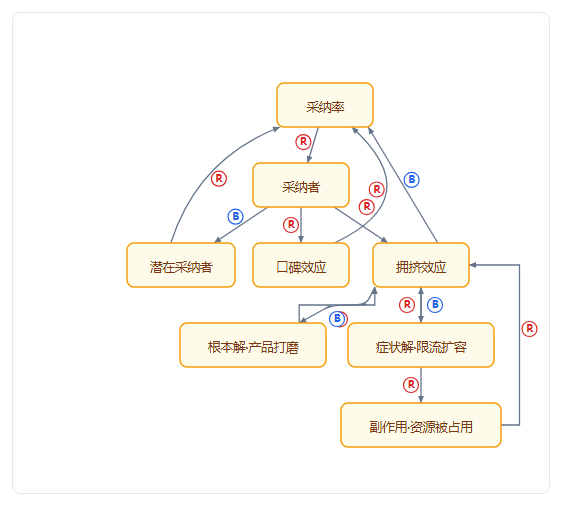
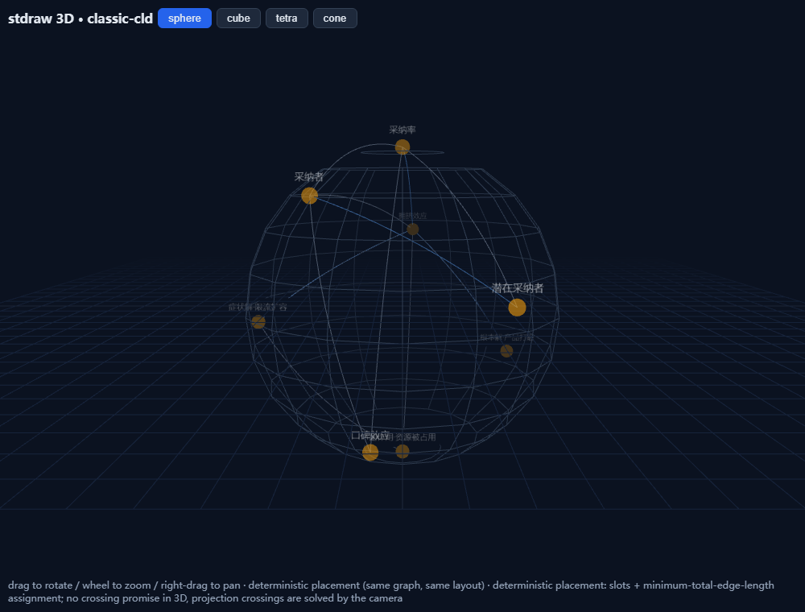
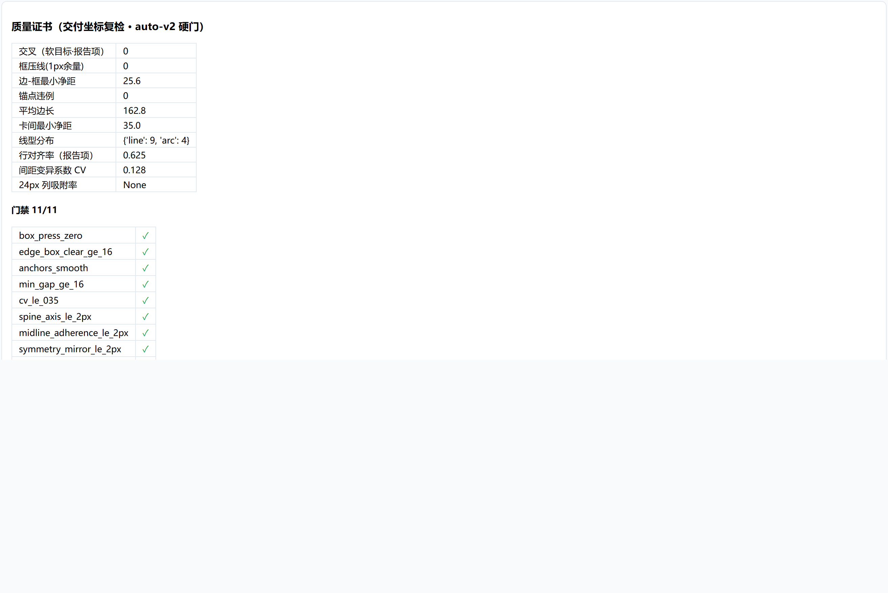
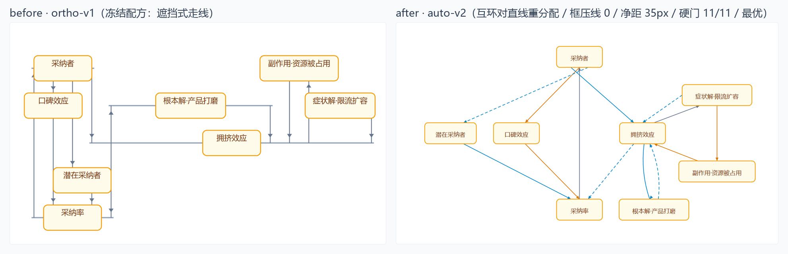

<div align="center">

# stdraw

**Planarity-aware 系统思维图引擎。诚实分级、硬质量门、带量化证书的交付。**

*Text DSL 进 → 带质量证书的图出。诚实分级，绝不冒充「零交叉」。*

[English](README.md) | 简体中文

</div>

[](https://github.com/jacky510/stdraw/actions/workflows/ci.yml)
[](LICENSE)
[](pyproject.toml)
[](https://github.com/jacky510/stdraw/stargazers)

[安装](#安装) · [Gallery](#gallery) · [Quickstart](#get-started--quickstart) · [DSL](#dsl-一分钟) · [证书与硬门](#certificates--质量证书) · [Agent 集成](#agent-integration)

```bash
pip install stdraw
```

> 面向 agent host 的机器消费文档（[AGENTS.md](AGENTS.md)、[skills/stdraw/SKILL.md](skills/stdraw/SKILL.md)）以英文为准；DSL 规范（[docs/dsl-spec-v0.1.md](docs/dsl-spec-v0.1.md)）暂为英文，中文版在规划中（不做日期承诺）。

---

## What & Why

主流图工具全停在「交叉最小化」启发式，并且**没有一个敢对自己的输出做承诺**。stdraw 反过来：

- **auto-v2（默认配方）**：分层 + 交叉数进目标函数（CP-SAT 精化可选）+ 直线/弧线一等布线，带**硬质量门**：框压线=0（任何角度）、边-框净距≥16px、锚点平滑、简单图（≤10 节点）对称/规律排布；
- **回路主导小图环形排布（v0.5.0）**：小图（≤12 节点）存在覆盖 ≥ n−2 节点的主环（或环边占比 ≥90%）时，主环按环序上**正多边形环槽位**（优先声明环序——R/B 极性徽标沿环可读）、弦走环内、残节点确定性环内/环外指派；证书切换为**环形口径指标**（环上等间距 CV + 正多边形模板拟合误差），不再拿行对齐门槛误判环形排布；不触发的图保持分层路径逐字节不变；
- **WS3 布线数学**：绕障是**可证最短**——障碍按净距膨胀后，在角点可见性图上跑精确 Dijkstra 最短路（图上最优）；折角以相切圆弧平滑（G1 切线连续、曲率有界、逐弧净距复核）；交叉按**双口径**复检——路由理论口径（最终路线）必须等于交付坐标几何复检，不一致拒发证书；R/B 极性标记随局部切线确定性放置，不遮字不压线；
- **ortho-v1（经典配方，可选）**：平面嵌入 + st 编号 + 可见性表示，可平面图的线全竖直、**0 交叉有定理保证**（行为冻结，逐字节回归保护，供生产调用方 pin 用）；
- **诚实分级**：拿不到证书就如实说拿不到——**绝不宣称任意图 0 交叉**（auto-v2 的交叉数是目标函数最小化项，不是定理保证）；
- **框界真值两层验证**：布局侧按真实字体最坏度量规划框界；验证侧在真实渲染后量 DOM 实际框界——证书量的是渲染真值，不是估算值；
- **质量证书**：每一次交付都带量化证书（交叉 / 框压线 / 净距 / 对齐 / CV / 锚点），验证跑在交付坐标上；
- **确定性**：同输入同输出，逐字节一致（CP-SAT 固定单 worker + 种子），图进版本库 diff 干净。

## Gallery

全部为当前引擎（v0.5.0）对仓内语料的真实渲染截图——非手改、非旧版残留（点击跳转对应 demo）。

| | |
|---|---|
| <a href="../demos/classic-cld-2d.html"></a> | <a href="../demos/classic-cld-3d.html"></a> |
| **2D · auto-v2 环形布局**（增长极限×转嫁负担，8n/13e，主环正多边形槽位、弦走环内、0 交叉） | **3D · 球面排布**（任意角度旋转，投影交叉由相机解决） |
| <a href="../demos/classic-cld-2d.html"></a> | <a href="../demos/classic-cld-2d.html"></a> |
| **质量证书面板**（硬门 + 门禁 + 诚实分级，随 demo 交付；环形口径：环上等间距 CV + 模板拟合） | **前后对比**（同一输入、当前引擎双配方渲染：ortho-v1 冻结配方线从卡下穿过 → auto-v2 环形布局、门禁 9/9、0 交叉、R/B 极性徽标沿环可读） |

## 对 agent 说人话

stdraw 是 agent 原生工具：一份 `.cld` 文本进，带证书的图出。你可以直接对 agent 说：

| 你说 | agent 跑 |
|---|---|
| 「帮我把这张因果回路图画出来，要带质量证书」 | `stdraw layout model.cld --outdir out` |
| 「审计这个文件里声明的反馈环：有没有不闭合的、极性标错的？」 | 看 `out/loops_audit.json` 的 `problems`（独立枚举全图回路对照） |
| 「这张图能零交叉吗？拿不到就直说，别吹」 | 看 `out/certificate.json` 的 `grade`（诚实分级，见下） |
| 「给一张能打印的版本」 | 打开 `out/demo-2d.html`（内联 SVG，零联网） |

## Project Structure

```text
stdraw/
├── stdraw/              # Python 包
│   ├── recipes.py       #   配方注册表：auto-v2（默认）/ ortho-v1（冻结，pin-safe）
│   ├── layout_auto.py   #   auto-v2 布局（分层 + 交叉进目标 + CP-SAT 可选精化 + 局部精化）
│   ├── routing.py       #   直线/弧线/绕行布线（框不压线、净距≥16px 硬门）
│   ├── textmetrics.py   #   框界真值（布局侧：真实字体最坏度量）
│   ├── rendercheck.py   #   框界真值（CI 侧：无头浏览器 DOM 实测，可选层）
│   ├── visibility.py    # WS3：布线数学（膨胀障碍可见性图最短路 + 弧平滑）
│   ├── crossing_exact.py  # WS2：精确交叉数层（OIL 插入 ILP + 平面化 oracle + B&B 夹逼，可选 ortools）
│   ├── regularity.py    # WS2：结构检测 + 规律性可计算定义（正多边形偏差/直线度/对称轴）
│   ├── placement.py     # WS2：槽位离散化放置（结构驱动槽型；general 分支 CP-SAT）
│   ├── ringlayout.py    # v0.5.0：回路主导环形排布（触发判定 + 主环正多边形槽位 + 残节点指派）
│   ├── planar.py        #   ortho-v1：2D 平面布局（0 交叉定理保证，行为冻结）
│   ├── layout3d.py      #   3D 五形体排布（球面/立方体/四面体/圆锥）
│   ├── metrics.py       #   质量证书 v1/v2 + 诚实分级
│   ├── check.py         #   几何自检（CI 门禁形态：v1 11 项 / v2 硬门 11 项）
│   ├── loops.py         #   环路语义审计（lint）
│   ├── dsl.py           #   .cld DSL 解析器
│   ├── model.py         #   图数据模型
│   ├── render.py        #   2D HTML 渲染（内联 SVG，v1/v2 双形态）
│   ├── render3d.py      #   3D HTML 渲染（three.js）
│   └── __main__.py      #   CLI：stdraw layout ... [--recipe auto|ortho] [--linestyle straight|arc]
├── examples/            # .cld 案例（增长极限 / 增长极限×转嫁负担）
├── demos/               # 交付形态：2D/3D demo + 证书 JSON
├── viewer/              # 零依赖交互查看器（四形态 + 页面内实时证书）
├── skills/stdraw/       # Agent Skill（skills add 即装）
├── tests/baselines/     # ortho-v1 逐字节回归基线（生产行为冻结铁门）
├── docs/                # DSL 规范 + gallery + OR-Tools 对比 + 精确交叉数数学（WS2）
└── .github/workflows/   # CI：配方回归 + 新硬门 + DOM 实测 + 确定性
```

## Get Started / Quickstart

```bash
# 1. 安装（纯 pip，唯一硬依赖 networkx）
pip install stdraw

# 2. 跑一个案例：文本 DSL 进
stdraw layout examples/limits-to-growth.cld --outdir out --pitch 62

# 3. 看交付形态
#    out/demo-2d.html     — 2D 布局 + 内嵌质量证书
#    out/demo-3d.html     — 3D 球面/立方体/四面体/圆锥排布（需同仓 assets/）
#    out/certificate.json — 指标 + 诚实分级
#    out/loops_audit.json — 环路语义审计
```

仓库内已有跑好的交付形态：直接打开 [`demos/classic-cld-2d.html`](demos/classic-cld-2d.html) / [`demos/classic-cld-3d.html`](demos/classic-cld-3d.html)。
交互查看器（四形态 + 节点拖拽 + 环路面板）：浏览器打开 `viewer/index.html`，无需安装任何东西。

### 手动微调闭环（拖拽 → 导出 → 复算证书）

每份 `demo-2d.html`（auto 配方）都内置微调层——直接拖卡片（鼠标/触摸），
顶栏指标实时复算，然后：

```bash
# 1. 打开 out/demo-2d.html，拖动卡片，点「导出布局」
#    -> 下载 graph-manual-layout.json（layout.json 兼容子集）

# 2. 按你的坐标重跑布线+证书——硬门口径不变、如实评分
#    （手动布局绝不因「是人排的」就放水）：
stdraw layout input.cld --outdir out-manual --skip-3d --from-layout graph-manual-layout.json

# 3. （可选）auto vs manual 双证书对照（差距即引擎与人的审美距离）：
stdraw layout input.cld --outdir out-manual --skip-3d \
    --from-layout graph-manual-layout.json --compare-auto

# 4. 三层 diff（节点位移 / 结构指标 / 回路语义）——从人工编辑里
#    归纳审美规律的数据源：
stdraw layout-diff out/layout.json out-manual/layout.json --cld input.cld --diff-out diff.json
```

## DSL 一分钟

行导向文本，`#` 起注释：

```ld
graph "增长极限×转嫁负担"
var rate "采纳率"
rate -> + adopters @loops R1,B1,B2      # 极性边 + 回路标签
loop R1 "采纳扩散" "R" [rate, adopters, word]
```

最小闭环 = 变量 / 极性边 / 回路标签 / 分组（可选，布局层不消费分组——布局由关系唯一决定）。
回路标签不是注释——lint 层验证闭合性与 R/B 极性奇偶，独立枚举全图回路对照（抓过「声明环不闭合」「极性标错」）。
规范全文：[docs/dsl-spec-v0.1.md](docs/dsl-spec-v0.1.md)（暂英文，中文版规划中，不做日期承诺）。

## Certificates · 质量证书

每个交付目录里的 `certificate.json`：

```json
{
  "metrics": { "crossings": 0, "box_press_1px": 0, "edge_box_min_clear": 18.0,
               "min_card_gap": 40.0, "row_align_rate": null,
               "spacing_cv": 0.405, "ring_spacing_cv": 0.0,
               "ring_template_deviation": 0.0, "mutual_pair_min_sep": 15.8,
               "line_line_coincident_pairs": 0 },
  "gates":   { "crossings_zero": true, "box_press_zero": true,
               "edge_box_clear_ge_16": true, "anchors_smooth": true,
               "min_gap_ge_16": true, "ring_spacing_cv_le_005": true,
               "ring_template_fit_le_005": true,
               "mutual_pairs_separated": true, "routing_consistent": true,
               "lines_no_coincidence": true },
  "placement": "ring-cycle",
  "grade": "最优"
}
```

（环形排布证书：行对齐率/列吸附如实为 `null`——规律性门按排布模式切换为
环上等间距 CV + 正多边形模板拟合误差；分层布局仍用行对齐口径。）

诚实分级语义（分级铁律：**绝不冒充成品**）：

| 级别 | 定义（auto-v2） |
|---|---|
| **最优** | 硬门全过（框压线 0 / 边-框净距≥16 / 锚点平滑 / 规律排布）+ 线 0 交叉 |
| **其次** | 硬门全过 + 交叉 ≤2 处（坐标入证书供人复核；互斥时保硬门、放交叉） |
| **最次** | 升维 3D：任意角度旋转，空间无交叉，投影交叉由相机解决 |
| **未获证书** | 其余情况——如实不评级 |

另有 `geometry_report.json`（几何自检，CI 门禁形态，fail>0 时 CLI exit 1）可直接当回归门禁用。

**精确交叉数层（WS2，`--exact`）**：CLI 可计算可证明的交叉数 cr(G)
（排序式插入 ILP + 平面化 oracle 裁决 + 可平面子图 × 全嵌入的 B&B 夹逼）。
证书随之携带 `exactness` 块的 `proven_optimal` / `gap` / `lb` / `crossing_number`
——并附严谨范围声明：最优性只相对 [docs/crossing-exact.md](docs/crossing-exact.md)
§0–5 定义的模型类成立，不虚称全体指标集。需要可选求解层
（`pip install "stdraw[solver]"`）；未装时字段如实 `computed: false`。
布局另附可计算**规律性**块（结构驱动：环图→正多边形偏差、链图→直线度、
对称轴对齐度；定义见 docs/crossing-exact.md §7）。

### Recipes · 配方

| 配方 | 线型 | 保证 | 适用 |
|---|---|---|---|
| `auto-v2`（默认） | 直线/弧线一等（`--linestyle straight\|arc`） | 硬质量门 + 交叉最小化（CP-SAT 可选 `pip install "stdraw[solver]"`）；回路主导小图（≤12 节点）走环形排布 + 环形口径门 | 一般 CLD / 教学 / 报告 |
| `ortho-v1`（`--recipe ortho`） | 全竖直正交 | 可平面图 0 交叉定理保证（**行为冻结**，CI 逐字节回归） | 生产调用方 pin / 正交风格偏好 |

## Agent Integration

| Agent host | 接入方式 |
|---|---|
| 任意能读文件的 agent | 读 [AGENTS.md](AGENTS.md)（仓根，agent 使用说明书，英文） |
| Agent Skills 生态 | `npx skills add jacky510/stdraw` → 安装 [skills/stdraw/SKILL.md](skills/stdraw/SKILL.md)（英文） |
| 脚本 / CI 门禁 | `pip install stdraw` → `stdraw layout ...` → 断言 `certificate.json` / `geometry_report.json` |
| MCP server | 规划中（见 AGENTS.md 预留位） |

## Limitations（诚实边界）

- **绝不宣称任意图 0 交叉**：auto-v2 的交叉数是目标函数最小化项而非定理保证；ortho-v1 在不可平面输入抛 `NotPlanarError` 诚实降级，不硬画。
- ortho-v1（冻结配方）的「无关线遮挡式穿卡」为 legacy 设计允许（卡片不透明），证书如实计数——这是 v0.1 已知边界，**v0.2 默认配方 auto-v2 已把框压线定为硬门（=0）**。
- 3D 层不做 2D 交叉承诺——空间弦线不相交由维度冗余保证，投影交叉由相机解决。
- 布局层是可替换实现（当前：分层 + 交叉最小化 + 直线/弧线布线；CP-SAT 为可选精化层，未装时构造法降级，质量回退但功能齐全）。
- 局部搜索邻域为行内横移与相邻交换，不含跨行搬移——个别图的最后一处交叉可能需要更大邻域（路线图 M3）。

## License

[MIT](LICENSE) © stdraw contributors
